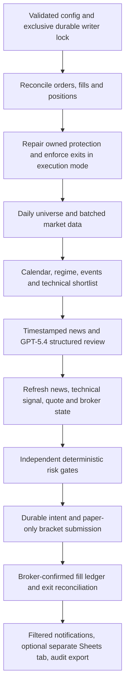
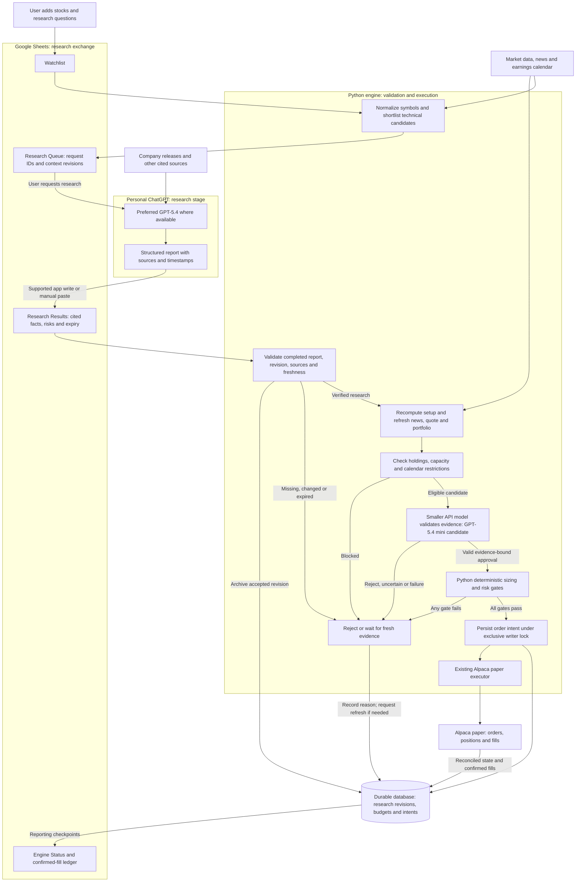

# Architecture

## Runtime flow

| Module | Responsibility |
|---|---|
| `config.py`, `models.py` | Frozen validated settings and UTC-aware data contracts |
| `calendar.py` | NYSE sessions, DST, holidays, early closes, bar completion, holding sessions |
| `providers.py` | Official Alpaca clients, bounded transport, read retries, SDK pagination, batches and incremental caches |
| `universe.py` | Active/tradable supported assets, metadata exclusions, 20-day dollar volume, daily snapshots |
| `signals.py` | Preserved breakout/pullback logic plus seven setups, relative strength and regime evidence |
| `evidence.py` | Alpaca news normalization, hourly Finnhub earnings snapshots, optional macro calendar, event chronology |
| `ai.py` | Official OpenAI Responses structured parsing, strict approval/citation binding, durable budget/cache |
| `risk.py` | Shared deterministic entry, sizing, exposure, sector and correlation gates |
| `execution.py` | Paper adapter, durable submission intents, owned fill reconciliation, stop/target coverage, recovery |
| `state.py` | SQLite/PostgreSQL journal, writer locks, cache and budget state, forward research export |
| `reporting.py` | Confirmed fills, dedicated Sheets schema, allowed alerts, Saturday report |
| `research.py` | Ordered simulation with the shared risk engine and archived-evidence comparison |
| `observation.py` | Forward-only 5/15-session price markouts for rejected candidates; never brokerage fills |
| `pipeline.py`, `cli.py` | Orchestration and strictly separated operating modes |

GPT-5.4 is the preferred model for the current API review. The proposed two-stage
research/validation design is documented in [Future enhancements](FUTURE_ENHANCEMENTS.md).
That design adds a Sheets watchlist and personal ChatGPT research handoff; it is
planned, not implemented. Current Sheets support still only exports confirmed fills.

## Planned Sheets and ChatGPT research architecture

**Future enhancement, not the current execution path.** Personal ChatGPT research
starts with a user-invoked handoff. Connected-app write-back or scheduling is added
only after the account's supported capabilities are verified.

Research expiry and technical-signal expiry are separate. A late report requires
a fresh setup; it cannot revive an expired signal. The smaller model has no broker
credentials and cannot change risk limits. Python owns every order decision, and
existing-position protection continues independently of research availability.
Sheets is an exchange surface; durable execution state stays in the database.

See [Future enhancements](FUTURE_ENHANCEMENTS.md) for the tab schemas, report
contract, rollout phases and acceptance criteria.

## Sources of truth

Alpaca owns actual positions, order states, cumulative fills and account resources.
The database owns strategy ownership/intents, AI decisions, evidence fingerprints,
cost reservations, fill checkpoints/cost basis and notification checkpoints.
A symbol or `sw-` prefix alone never grants ownership of an old/manual position.
The sum of owned buy minus sell fills must match the broker quantity before modification.

Local SQLite uses WAL, FULL synchronization and an exclusive OS file lock held for
the invocation. Scheduled AI/execution requires `DATABASE_URL` and a PostgreSQL
session advisory lock held for the whole invocation. Connection loss stops work;
there is no transparent reconnection under a stale lock. Use the same database
and account for every executor. Never run a second local executor with separate state.

PostgreSQL is an explicit external dependency for scheduled execution, not a
mandatory paid server for observation. Use an existing persistent database or a
suitable free service after reviewing uptime, backup, privacy and retention terms.
Actual PostgreSQL operation has not been verified in this environment.

GitHub artifacts are immutable audit exports, not critical trading state. GitHub
concurrency is a second layer, not the cross-process lock. Cold observation can run
without a prior artifact/cache. Scheduled AI cannot reset spending limits each run.

## Audit schema

The database creates three small tables (no credentials are stored):

| Table | Columns / semantics |
|---|---|
| `audit` | `id` unique event key, `at` UTC capture time, `kind`, JSON `payload` |
| `intents` | deterministic client `id`, `symbol`, JSON candidate/approval/plan payload, broker/ambiguity `state` |
| `kv` | namespaced `key`, JSON `value` for cache, budgets, fills, cost basis, notification checkpoints |

Important audit kinds: `universe`, `coverage`, `data_refresh`, `signal`, `regime`,
`earnings_funnel`, `news`, `calendar_snapshot`, `ai_decision`, `ai_failure`,
`research_record`, `candidate_rejected`, `risk_approved`, `conditional_setup`,
`order_ack`, `fill`, `portfolio`, `exit_policy`, `scan`, and explicit failure events.
Every confirmed fill has broker order ID, cumulative checkpoint-derived delta
quantity/price, capture and broker timestamps, setup, initial stop/target and realized
P&L for sells. Broker `updated_at` is used when a partial order has no `filled_at`;
this is not represented as a separate exchange execution timestamp.

Fill journal, cumulative checkpoint and average cost basis update in one transaction.
Repeated broker snapshots cannot duplicate fill events. Submitted acknowledgements
are not fills. Stable client IDs survive workflow retries. An ambiguous reserved
intent remains blocked until broker evidence or deliberate operator reconciliation
resolves it; absence from one response never permits blind resubmission.

`reports/audit.jsonl` exports the journal. `forward_archive.json` exports original
candidate/approval/news/event packages and calendar coverage snapshots for later
point-in-time research. Exact candidate hashes must match; changed historical data
or universe/regime context causes a deferred comparison, not a fabricated approval.

## Interface references checked during implementation

- [Alpaca order and bracket documentation](https://docs.alpaca.markets/us/docs/orders-at-alpaca)
- [Alpaca Python historical client](https://alpaca.markets/sdks/python/api_reference/data/stock/historical.html)
- [Alpaca news endpoint](https://docs.alpaca.markets/us/reference/news-3)
- [OpenAI structured outputs](https://developers.openai.com/api/docs/guides/structured-outputs)
- [Finnhub official calendar client methods](https://github.com/Finnhub-Stock-API/finnhub-python/blob/master/finnhub/client.py)

The pinned Alpaca SDK's market-data pagination and NewsSet contract are tested
with synthetic API-shaped responses. Public citations establish interfaces, not
account entitlements. Those require the actual read-only service checks.
