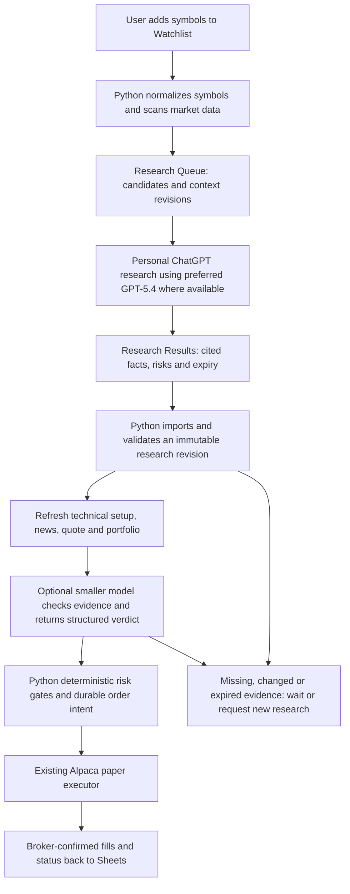

# Future enhancements

## Sheets watchlist and staged AI research

Status: planned; not implemented. Requested on 2026-11-22.

The user can paste watchlist symbols into Google Sheets, the Python engine can
publish technically qualified candidates, and personal ChatGPT can research those
symbols and return cited findings. Python imports the research, refreshes market
evidence, and optionally uses a smaller API model for structured validation before
its deterministic risk and order-management code makes any broker request.

This is a useful separation of slower research from timely execution. Sheets is a
human-readable exchange surface. The database remains the authority for imported
research revisions, decisions, execution intents, budgets and checkpoints; Alpaca
remains the authority for orders, fills and positions.

GPT-5.4 is the preferred research/review model. It is also the current API default
until the staged design is implemented and validated. GPT-5.4 mini is a candidate
for the later validation stage, not an enabled fallback or an execution agent.
Personal ChatGPT model availability is separate from the API model setting: request
the preferred model where available and record the actual model, or explicitly
record it as undisclosed rather than inferring it from an API model name.

### Proposed sheet layout and ownership

Use dedicated new tabs in the user's chosen spreadsheet; preserve existing
portfolio tabs and the current `Alpaca Paper Fills` ledger. Confirm the destination,
tab names and available read/write permissions during implementation.

| Tab | Writer | Purpose and minimum fields |
|---|---|---|
| `Watchlist` | User | Stable watch ID, symbol, enabled flag, priority, question/research intent; never order instructions |
| `Research Queue` | Python | Request ID, symbol, origin (watchlist/scanner), context revision/hash, requested-at UTC, setup snapshot, research questions, status |
| `Research Results` | ChatGPT or user-assisted import | Request ID, report ID/revision, schema version, symbol, research-as-of UTC, valid-until UTC, source references, cited facts, thesis, contradictions, upcoming events, missing information, invalidation conditions, model/provenance, completion marker |
| `Engine Status` | Python | Request/report IDs, import disposition, rejection reason, fresh signal ID, decision, intent/order ID when present; research status is separate from execution status |
| `Alpaca Paper Fills` | Existing Python reporter | Existing confirmed-fill schema, unchanged; a proposed order never appears as a fill |

Represent source evidence as structured records containing URL, publisher, title,
publication/update time when available, capture time, relevant excerpt and the
fact it supports. For larger reports, keep a canonical payload in durable storage
and put its reference/hash in the sheet. A narrative recommendation or numeric
confidence by itself is insufficient. Do not store secrets in any tab.

### Import, freshness and execution contract

1. Normalize and validate watchlist symbols against supported tradable assets.
   Deduplicate work by symbol and material research context; multiple technical
   setups can reference one research report without forcing another research run.
2. Assign stable IDs and revisions; never identify work by sheet row number.
   Import only explicitly completed reports with a valid schema and matching
   request, symbol and revision. Read back a consistent revision/content hash;
   incomplete writes, conflicting edits or concurrent changes require retry or
   rejection. Finalized report edits create a new revision and invalidate any
   downstream decision bound to the previous revision.
3. Treat sheet content and research as untrusted evidence. Verify source identity,
   timestamps, symbol/entity and cited facts against captured source material.
   Unsupported claims, missing sources, instructions embedded in news, and
   unresolved material contradictions prevent a positive verdict. Use RAW writes
   and do not execute sheet formulas, URLs or free-text commands as instructions.
4. Separate research validity from signal validity. Research can take minutes or
   hours; the original 15-minute technical signal will often expire. A valid thesis
   must be paired with a newly computed setup and fresh quote before entry.
   Research TTL depends on the catalyst and session; material news or an earnings
   release invalidates it immediately. A completed research row never revives an
   expired trade approval or authorizes an order by itself.
5. Before any small-model call, check position ownership, pending entries, available
   slots, calendar restrictions and other cheap deterministic exclusions. Send only
   the relevant verified research, fresh candidate, new/contradictory evidence and
   required schema. The smaller model returns APPROVE, REJECT or UNCERTAIN with
   evidence bindings; it cannot invent missing evidence or access broker credentials.
6. Bind the result to the report revision, fresh candidate and evidence hashes,
   model, prompt/schema version and expiration. New contradictory evidence requires
   renewed research or rejection; a smaller model cannot erase an unresolved risk
   merely to convert an UNCERTAIN or REJECT result into APPROVE.
7. Python performs all final sizing, spread, freshness, earnings, exposure, sector,
   correlation, cash and ownership checks. Only the existing paper executor can
   submit an order, under the existing activation gates and database writer lock.
   Repeated sheet reads cannot duplicate broker intents or fills.
8. Record request/report revisions and import outcomes in the database before
   acknowledging them in Sheets. Use a durable reporting outbox and stable keys
   to recover a crash between database commit and sheet acknowledgement. Sheets
   provides no transactional order queue; a spreadsheet status is not the broker
   submission checkpoint. Research/Sheets failures block dependent new entries
   while owned-position protection and exit management continue independently.

### Personal ChatGPT handoff and automation limits

Phase one is explicitly user-invoked: open the research queue in personal ChatGPT,
request research, then use a supported Sheets write action or paste the structured
result into the designated results tab. The Python importer does not need a timed
ChatGPT response or assume that changing a cell triggers research automatically.

Connected-app reads, writes, background runs and approvals depend on the actual
ChatGPT plan, interface, app and account permissions. Verify a complete read,
research and write-back round trip before scheduling anything. Do not assume a
Plus subscription supplies an unattended worker or the exact API model requested.
There is no browser-scraping/session-cookie automation of personal ChatGPT.

For later unattended research, use a supported connected-app/task workflow only
after its capabilities are demonstrated, or implement an explicit API research
worker using GPT-5.4. An API worker needs a real news/retrieval source or supported
search tools: the current AIService has no browsing tools. API research and
validation have separate token/cost budgets; ChatGPT subscription usage is tracked
separately. Provider sharing allowances are conditional billing benefits, never a
reason to remove local cost controls, and do not cover every tool charge.

### Implementation phases and acceptance criteria

1. **Watchlist and queue, observation only.** Add a separate opt-in Sheets input
   adapter; import the user's symbols and publish deduplicated candidate requests.
   Preserve all existing sheet data. Validate schema, symbol errors, RAW writes,
   row moves, repeated polls, pagination and access failures with fixtures first.
2. **Research handoff, dry-run only.** Implement the report schema, revisioned
   importer, source verification, durable journal and acknowledgements. Demonstrate
   a user-invoked personal ChatGPT round trip. Reject stale, future-dated, wrong-symbol,
   unsupported, partial and edited reports; prove the dry run creates no orders.
3. **Smaller-model comparison.** Compare GPT-5.4 mini against preferred GPT-5.4 on
   the same fixed, independently reviewed evidence packages. Measure unsupported
   claim rate, missed risk/contradiction rate, false approvals, abstentions, JSON
   validity, total tokens including reasoning, latency and paid-equivalent cost.
   Define acceptance thresholds before evaluation; do not equate agreement between
   models or a short profitable backtest with factual accuracy.
4. **Guarded paper integration.** Enable consumption only after the importer and
   model comparison pass and the existing paper activation/recovery requirements
   are met. Test duplicate reports, ambiguous order responses, database crashes,
   sheet outages, model failures and research changes between validation and
   submission. No automatic downgrade or no-research bypass on failure.

The future adapter must have its own activation control. Existing `SHEETS_ENABLED`
continues to mean confirmed-fill reporting only. This roadmap does not add watchlist
imports, research writes, a smaller-model fallback, a ChatGPT schedule, or an
execution path to the running application.

### References checked

- [GPT-5.4 model, structured outputs and pricing](https://developers.openai.com/api/docs/models/gpt-5.4)
- [Connected apps in ChatGPT and capability/permission differences](https://help.openai.com/en/articles/11487775-connected-apps-in-chatgpt)
- [Reasoning tokens and output limits](https://developers.openai.com/api/docs/guides/reasoning)
- [Data-sharing allowance scope and exclusions](https://help.openai.com/en/articles/10306912-sharing-feedback-evals-and-api-data-with-openai)
